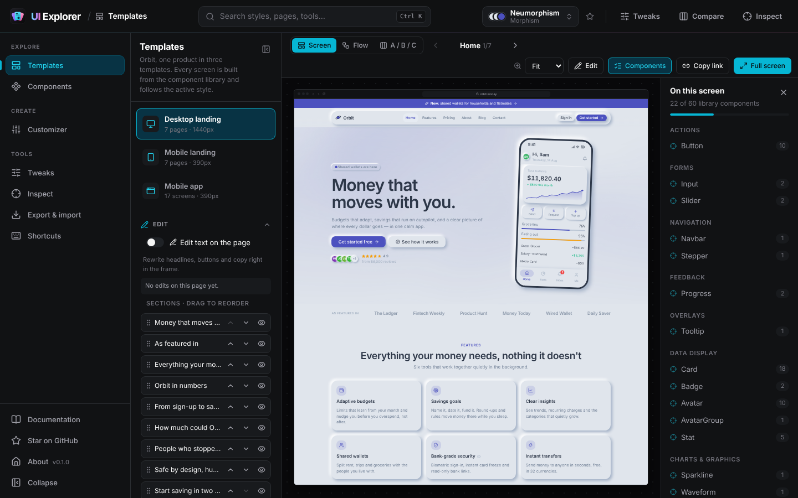
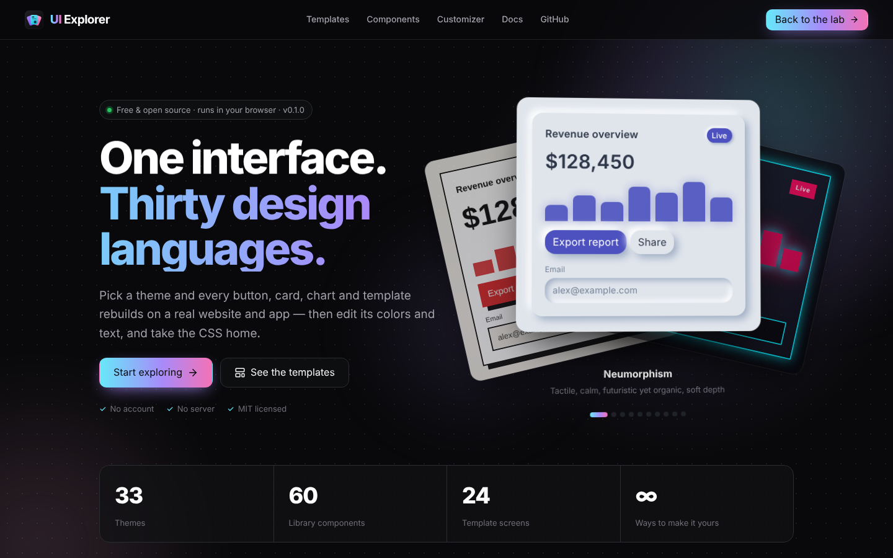
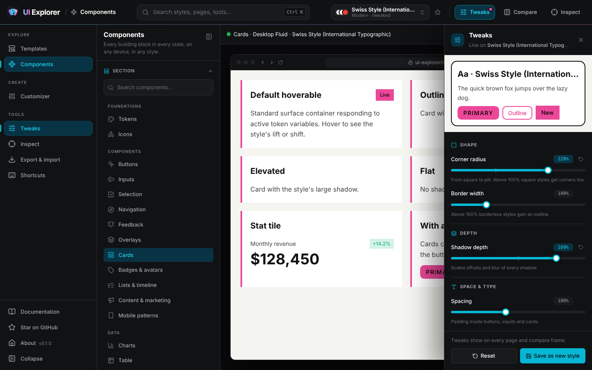
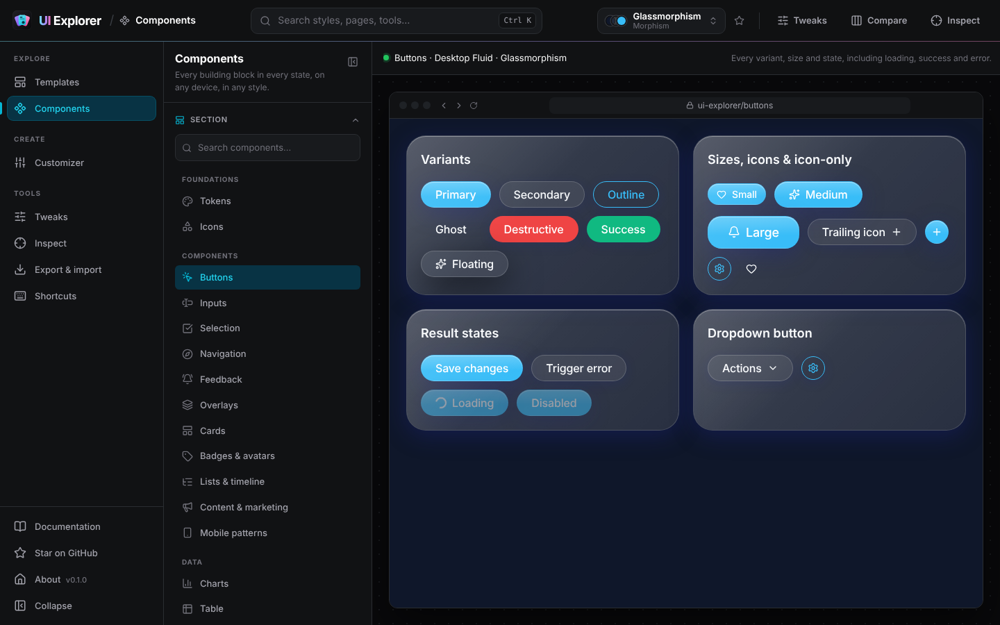
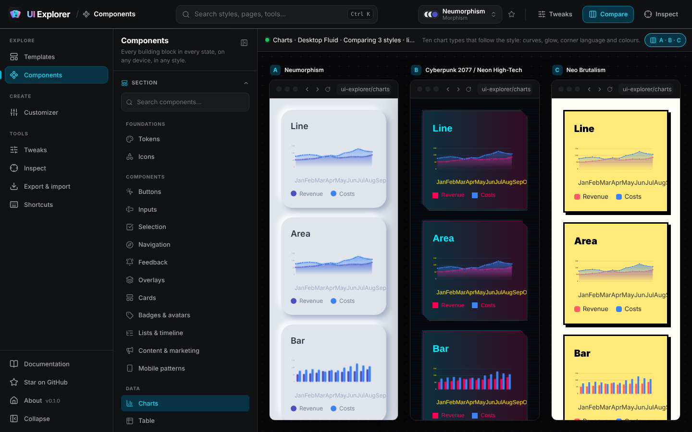
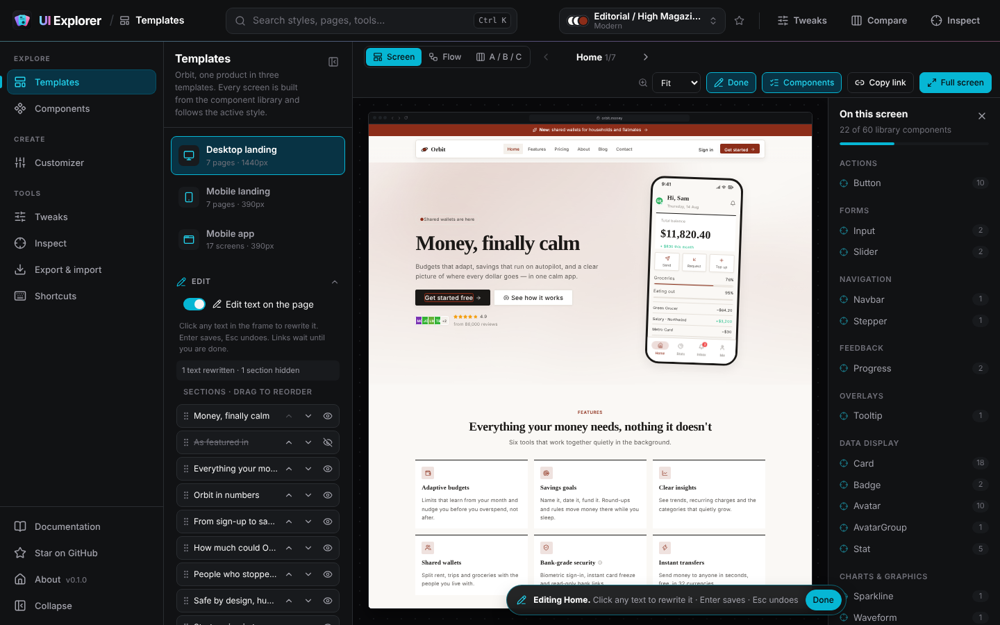
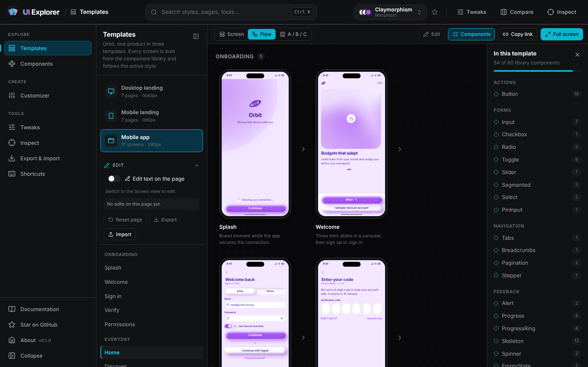
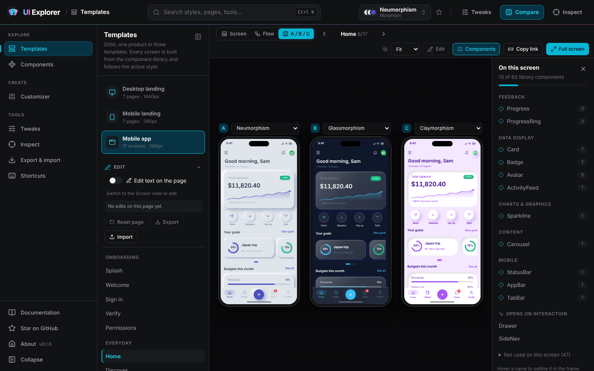
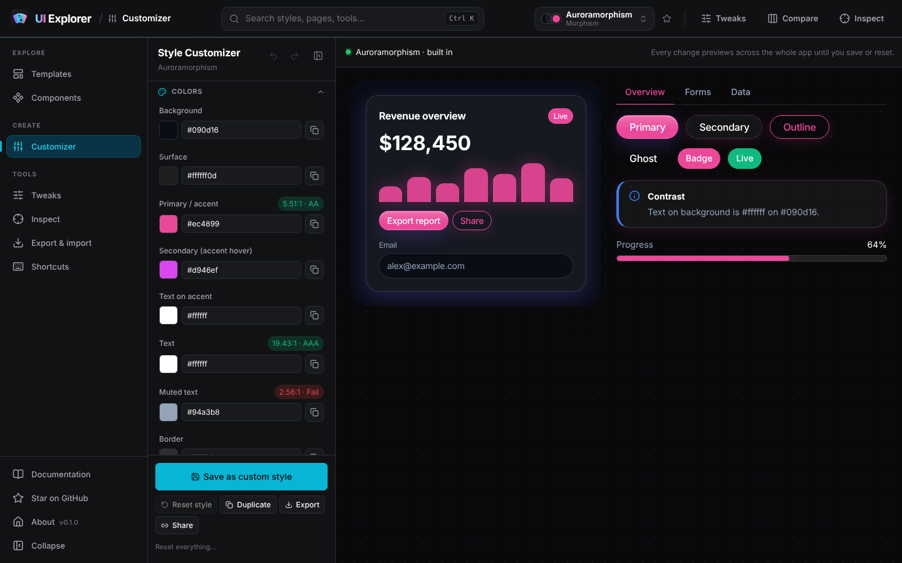

<p align="center"></p>

# UI Explorer

> Pick a theme, see it on a real website, app and component library, edit its colors and text, and take the CSS home.

Thirty-three themes, from Neumorphism to Neo Brutalism, each defined as a
complete token system rather than a palette swap, rendered through one real
component library. Switch a theme and every button, card, table, chart,
overlay and icon changes construction. Tune it by hand, inspect why anything
looks the way it does, and export the result.



**Live:** <https://chinto-lgtm.github.io/ui-explorer/> · **Docs:** <https://chinto-lgtm.github.io/ui-explorer/docs/>, both built from `main` by GitHub Actions.

## Features

### Templates

- One fictional product, Orbit, in three templates built only from the
  component library: a desktop landing site (7 pages), the same site on a
  phone, and a mobile app (17 screens across onboarding, home, goals, wallet,
  chat and account). Every theme restyles all of them.
- Fully clickable with no backend: links, forms, dialogs, sheets, menus,
  toasts, loading and empty states.
- Screen, Flow (every screen on one board) and A / B / C views, a live list of
  the components on screen that outlines them in the frame, share links, a
  full-screen preview, and an optional image of your own that stays in the
  tab's memory.
- **Editable in place:** rewrite any text right in the frame, hide and reorder
  landing sections, keep the edits in your browser and export them as JSON.

### Components

- A full component library (buttons, inputs, selection, navigation, feedback,
  overlays, data display, tables, notifications, content and marketing blocks,
  mobile patterns) and SVG charts (line, area, bar, donut, radial, sparkline,
  scatter, waveform) that all read the active theme.
- One Components page in three groups: Foundations (tokens, icons),
  Components and Data (charts, table, notifications). Desktop, tablet, mobile
  and custom viewports, rulers, a responsive inspector and A / B / C
  comparison.

### Themes

- 30 built-in themes across Morphism, Modern, Expressive, Futuristic, Retro
  and Minimalist, plus 3 community themes, each with its author credited.
- A searchable theme picker in the header with favourites and recently used
  themes.

### Tools

- **Tweaks** on every page: sliders for corner radius, border width, shadow
  depth, spacing, type size, accent colour and motion speed, live in the
  preview and every compare frame, saved as your own theme in one click.
- **Customizer** with a real colour picker and contrast readout, presets
  for every theme, undo/redo, section resets and app-wide live preview.
- **Inspect**: click any element to see the tokens behind it.
- **Export** as JSON tokens or CSS variables; import a theme file with
  validation; command palette (Ctrl+K) and keyboard shortcuts.

### The app

- One layout everywhere: a collapsible navigation rail, a searchable theme
  picker, a left panel that hides or becomes a drawer on phones, and a
  preview stage.
- Real addresses: every page, section, device, comparison and open tool lives
  in the URL, so anything you see can be linked and Back works.
- Motion throughout (Framer Motion): page entrances, gliding indicators,
  panels and an animated landing page, all respecting reduced motion.

## Screenshots

| | |
| --- | --- |
|  |  |
|  |  |
|  |  |
|  |  |

## Getting started

Requires Node.js 20+.

```sh
npm install
npm run dev        # http://localhost:5173
```

```sh
npm test           # vitest: engine, themes, components, templates, app
npm run lint       # oxlint
npm run build      # tsc + vite
```

Keyboard: `Ctrl+K` search · `Ctrl+.` tweaks · `Ctrl+E` customizer ·
`Ctrl+Shift+C` compare · `Ctrl+Shift+X` inspect · `?` all shortcuts.

## Deploying

The app is a static site with no backend. `npm run build` writes `dist/`,
which any static host serves as-is (Cloudflare, Netlify, Vercel, S3…).
For hosts that serve under a sub-path, set `VITE_BASE_PATH=/sub-path/` at
build time; `.github/workflows/deploy.yml` does this for GitHub Pages and
copies `index.html` to `404.html` so deep links resolve.

## Theming the app itself

The tool's own look (header, sidebar, workspaces, modals, the docs site)
comes from one file: [`src/theme.css`](src/theme.css). Change a value there
and everything follows; a test (`src/theme.test.ts`) fails if any chrome file
introduces a literal colour. The themes on show are separate data
(`src/styles/*.ts`) and are never affected.

## Project layout

```text
src/
  config/         routes.ts: the one list of pages and tools (router, rail, search, landing)
  engine/         types, resolver, registry, context, tweaks, vocabulary, colour, share links
  styles/         the 33 theme definitions, treatments, docs
  components/     ui primitives, charts, svg, preview, layout (shell), workspace (panel, stage, device frame)
  features/       tweaks, inspector, export, search, shortcuts
  hooks/          URL state, compare, keyboard shortcuts
  motion/         motion presets and the reduced-motion policy
  pages/          Landing, Templates, Components, Customizer
  templates/      the Orbit landing site and mobile app, their content, catalogue and visitor edits
docs/             guides and screenshots
```

## Contributing

- [CONTRIBUTING.md](CONTRIBUTING.md): how to add a theme or contribute code.
- [Design tokens](docs/guide/design-tokens.md): what a theme is made of.
- [Architecture](docs/architecture.md): how the app fits together.

The same pages are published as a documentation site (`npm run docs:dev`
locally; built by VitePress into `dist/docs`).

## License

[MIT](LICENSE)
